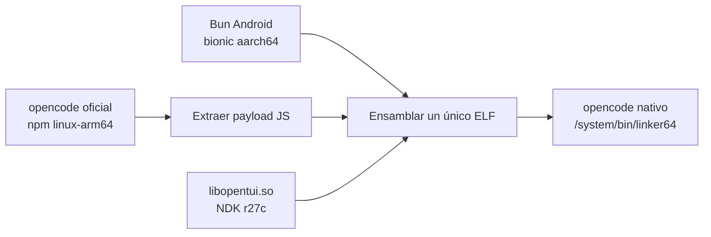
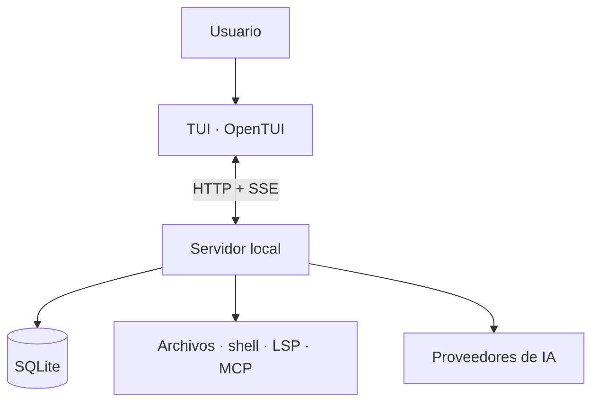
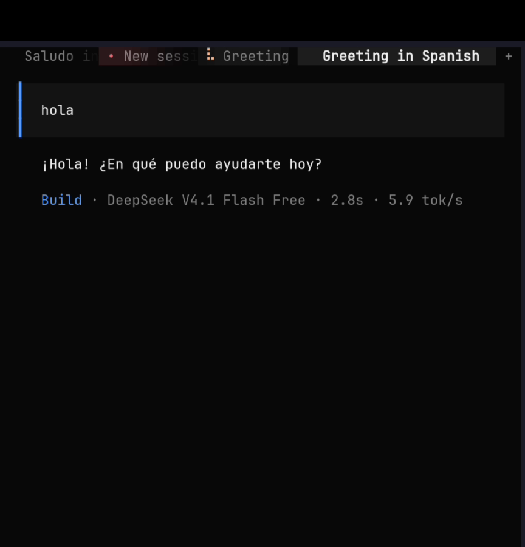

<div align="center">

# OpenCode en Termux

**Cómo funciona y qué hay detrás del port nativo para Android**

[](https://www.android.com)
[](https://termux.dev)
[](https://opencode.ai)

[](LICENSE)

</div>

> **Documentación técnica independiente.** Este repositorio explica cómo se ejecuta [OpenCode](https://opencode.ai) en [Termux](https://termux.dev) sobre Android, qué limita al binario oficial y cómo está construido el port comunitario nativo. No es un proyecto oficial de OpenCode, de Termux ni del mantenedor del port.

> **TL;DR** — OpenCode está hecho en TypeScript/Bun y se distribuye como binarios para Linux con **glibc**. Android usa **bionic** y `/system/bin/linker64`, así que ese binario no arranca. El port comunitario toma el runtime Android de Bun, injerta el payload de OpenCode y compila `libopentui` contra bionic con el NDK. El resultado es un único ELF aarch64 de ~270 MB que corre sin proot ni glibc.

---

## Índice

- [Qué es OpenCode](#qué-es-opencode)
- [El problema: glibc vs bionic](#el-problema-glibc-vs-bionic)
- [La solución: build nativo bionic](#la-solución-build-nativo-bionic)
- [Arquitectura en ejecución](#arquitectura-en-ejecución)
- [Instalación](#instalación)
- [Uso](#uso)
- [Seguridad](#seguridad)
- [Qué hay detrás](#qué-hay-detrás)
- [Rendimiento y límites](#rendimiento-y-límites)
- [Verificación en dispositivo](#verificación-en-dispositivo)
- [Demo](#demo)
- [Preguntas frecuentes](#preguntas-frecuentes)
- [Estructura del repositorio](#estructura-del-repositorio)
- [Créditos](#créditos)
- [Licencia](#licencia)

---

## Qué es OpenCode

[OpenCode](https://opencode.ai) es un agente de programación para la terminal. No es un editor ni una extensión: es un programa que conversa contigo, lee y modifica archivos, ejecuta comandos y usa herramientas del proyecto para resolver tareas.

Sus piezas principales:

- **TUI**: una interfaz de terminal con paneles, historial, diffs y selector de modelos.
- **Sesiones persistentes**: cada conversación conserva mensajes, tool calls y resultados.
- **Herramientas**: lectura/escritura de archivos, búsqueda (`glob`/`grep`), shell, LSP y servidores MCP.
- **Proveedores**: OpenCode Zen (con modelos gratuitos) o tus propias claves de Anthropic, OpenAI, Google, OpenRouter, etc.
- **Cliente/servidor**: la interfaz habla con un servidor local que ejecuta las sesiones y las herramientas.

En Linux de escritorio se instala como un binario autocontenido. En Android ese mismo binario no funciona, y ahí empieza la parte interesante.

---

## El problema: glibc vs bionic

Android es Linux, pero no es un Linux de escritorio. La diferencia que rompe la compatibilidad es la librería C y el cargador dinámico:

| Pieza | Linux tradicional | Android / Termux |
|---|---|---|
| Librería C | glibc | **bionic** |
| Cargador dinámico | `/lib/ld-linux-aarch64.so.1` | `/system/bin/linker64` |
| Binario oficial de OpenCode | `opencode-linux-arm64` (glibc) | no existe |
| Aislamiento | usuario normal | sandbox por aplicación |

El binario oficial de OpenCode es un ejecutable generado con `bun build --compile`. Su formato es, a grandes rasgos:

```text
[ runtime de Bun ] [ marcador "---- Bun! ----" ] [ payload JS de OpenCode ]
```

Ese ELF pide el cargador de glibc y símbolos que bionic no expone. En Termux falla al ejecutarse, aunque tengas todas las dependencias de Termux instaladas.

### Por qué no basta con compilarlo en el teléfono

`bun build --compile` tampoco es una salida limpia en Android: Bun intenta escanear el sistema de archivos desde `/` y el sandbox de Android le niega el acceso a `/data`:

```text
error: Cannot read directory "/data/": AccessDenied
```

También existen atajos con `proot` o `glibc-runner`, pero añaden una capa de traducción, latencia y problemas con `/proc/self/exe`. Para una TUI que se usa a diario, no es lo mismo que un binario nativo.

La solución real es compilar contra **bionic** y ejecutar con `/system/bin/linker64`.

---

## La solución: build nativo bionic

El port comunitario de [Hope2333/opencode-termux](https://github.com/Hope2333/opencode-termux) mantiene una línea **nativa bionic** para aarch64. La idea es tomar el runtime Android de Bun como base y trasplantarle el payload de OpenCode hasta obtener un único ELF ejecutable.



El pipeline, en simple:

1. **Extraer el payload.** Del paquete oficial `opencode-linux-arm64` se separa el grafo de módulos JavaScript que Bun incrusta después del marcador `---- Bun! ----`.
2. **Usar una base Android.** Bun incorpora builds nativos para Android/bionic desde la versión 1.3.14. Esa base ya está enlazada contra `linker64` y no necesita glibc.
3. **Trasplantar y revivir.** Se parchea la sección `.bun` (tamaño y metadatos), se ajusta el arranque y se ensambla un solo ELF con la base de Bun + el payload de OpenCode. El objetivo es que el binario arranque como `opencode`, no como el CLI de `bun`.
4. **Inyectar la TUI.** OpenCode v2 usa OpenTUI, cuyo núcleo nativo es `libopentui.so`. Esa librería se compila contra bionic con el NDK r27c y se inyecta en el bundle; en tiempo de ejecución aparece dentro del sistema de archivos virtual de Bun.
5. **Empaquetar.** Se publican `.deb` para apt/Termux y `.pkg.tar.xz` para pacman. El binario va a `$PREFIX/bin/opencode` y las librerías auxiliares a `$PREFIX/lib/opencode`.

### Resultado

| Propiedad | Valor |
|---|---|
| Formato | ELF arm64 dinámico, `interpreter /system/bin/linker64` |
| glibc | **ninguna** |
| Dependencias | `libc.so`, `libm.so`, `libdl.so`, `libopencode-crhandler.so` |
| API mínima | 28 (Android 9) |
| Build | NDK r27c |
| Descarga | ~69 MB (`.deb`) |
| Tamaño instalado | ~270 MB |
| TUI | OpenTUI + `libopentui.so` bionic |

No es un wrapper ni un entorno proot: es un binario nativo que el kernel ejecuta directamente.

---

## Arquitectura en ejecución

Al abrir `opencode`, la TUI arranca (o reutiliza) un servidor local en segundo plano y se conecta a él. La interfaz y el servidor hablan HTTP; los eventos de la sesión viajan por SSE.



El servidor local guarda una contraseña en `~/.config/opencode/service.json` y expone una API que también pueden usar otros clientes. De ahí salen subcomandos como `serve`, `api`, `pair` y `acp`.

### Comandos que revelan la arquitectura

| Comando | Función |
|---|---|
| `opencode` | Abre la TUI interactiva |
| `opencode run "..."` | Ejecuta una instrucción y termina |
| `opencode serve` | Inicia la API v2 y el servidor web |
| `opencode service status` | Estado del servidor en segundo plano |
| `opencode service stop` | Detiene el servidor en segundo plano |
| `opencode api` | Hace una petición al servidor en ejecución |
| `opencode pair` | Muestra los datos de emparejamiento |
| `opencode acp` | Inicia un servidor Agent Client Protocol |
| `opencode auth` | Gestiona proveedores y credenciales |
| `opencode models` | Lista los modelos disponibles |
| `opencode debug paths` | Muestra las rutas de datos, config, caché y estado |

### Dónde vive todo

| Ruta | Contenido |
|---|---|
| `~/.config/opencode/` | Configuración global, agentes, comandos y plugins |
| `~/.config/opencode/service.json` | Contraseña del servidor local |
| `~/.local/share/opencode/opencode.db` | Sesiones, mensajes y tool calls (SQLite + WAL) |
| `~/.local/share/opencode/log/` | Logs del servidor y de la TUI |
| `~/.local/share/opencode/repos/` | Datos de repositorios y checkpoints |
| `~/.local/share/opencode/shell/` | Snapshots del shell |
| `~/.cache/opencode/` | Caché y binarios auxiliares |
| `~/.local/state/opencode/` | Estado local |
| `$PREFIX/lib/opencode/` | `libopencode-crhandler.so` |

La configuración de proyecto se puede complementar con un `opencode.json` en la raíz del repo y un `AGENTS.md` con instrucciones para el agente.

---

## Instalación

### Requisitos

- Android **9 o superior** (API 28).
- Arquitectura **aarch64/arm64**.
- [Termux](https://termux.dev) (F-Droid, GitHub o Play Store; este último tiene más restricciones de almacenamiento).
- ~400 MB libres (el paquete instalado ronda los 270 MB).
- No necesitas root, proot ni un entorno glibc.

### Instalar el .deb nativo

Descarga el paquete `opencode_<versión>_aarch64.deb` desde [Releases](https://github.com/Hope2333/opencode-termux/releases) y instálalo con Termux:

```bash
pkg update && pkg upgrade -y
pkg install curl

# Versión de ejemplo; usa la última disponible en Releases
curl -LO https://github.com/Hope2333/opencode-termux/releases/download/Push261005/opencode_2.0.22_aarch64.deb
pkg install ./opencode_2.0.22_aarch64.deb

opencode --version
```

> El nombre del archivo cambia con cada versión. En Releases elige el `.deb` que empieza por `opencode_` y termina en `_aarch64.deb`. Los paquetes `-wrapper` y `-compressed` son variantes distintas; para la línea nativa usa el normal.

<details>
<summary>Alternativa con pacman</summary>

```bash
curl -LO https://github.com/Hope2333/opencode-termux/releases/download/Push261005/opencode-2.0.22-1-aarch64.pkg.tar.xz
pacman -U ./opencode-2.0.22-1-aarch64.pkg.tar.xz
```

</details>

### Actualizar y desinstalar

```bash
# Actualizar: descarga el nuevo .deb de Releases y repite la instalación
pkg install ./opencode_<nueva_versión>_aarch64.deb

# Desinstalar
pkg uninstall opencode
```

> En Termux, actualiza con el `.deb` del port. Evita `opencode upgrade` si no tienes claro a qué binario apunta: el instalador oficial está pensado para Linux con glibc.

---

## Uso

```bash
opencode                 # TUI interactiva
opencode run "resume este repositorio y dime qué hace"
opencode models          # modelos disponibles
opencode auth login      # configurar un proveedor con API key
opencode auth list       # ver credenciales guardadas
opencode service status  # estado del servidor en segundo plano
opencode serve --hostname 127.0.0.1 --port 4096
```

### Modelos gratuitos

OpenCode Zen ofrece modelos gratuitos que no requieren API key. La lista puede cambiar; consúltala con `opencode models`. Al momento de esta prueba incluía:

```text
opencode/beam-free
opencode/big-pickle
opencode/deepseek-v4.1-flash-free
opencode/flint-40b-free
opencode/glm-5.3-flash-free
opencode/mimo-v2.6-flash-free
opencode/nemotron-3-ultra-free
opencode/nemotron-3.5-lightning-free
opencode/nemotron-3.5-super-vl-free
```

Para usar Anthropic, OpenAI, Google, OpenRouter u otro proveedor:

```bash
opencode auth login
```

### Configuración rápida

Puedes fijar el modelo por defecto en `~/.config/opencode/opencode.json`:

```json
{
  "model": "opencode/deepseek-v4.1-flash-free"
}
```

Y dar contexto específico al proyecto con un `AGENTS.md` en la raíz del repositorio.

---

## Seguridad

- **Credenciales**: las claves se gestionan con `opencode auth` y se guardan en el directorio de datos local. No las subas a Git ni las pegues en `opencode.json`.
- **Servidor local**: `opencode serve` está pensado para escuchar en local. Si lo expones en la red, pon autenticación y TLS delante; no lo dejes abierto a Internet.
- **Permisos de herramientas**: el agente puede ejecutar shell y modificar archivos. Revisa las confirmaciones y no le des permisos amplios en proyectos que no controlas.
- **Modelos gratuitos**: cada proveedor aplica sus propias políticas de datos. No envíes secretos, tokens ni información sensible en prompts.

---

## Qué hay detrás

| Componente | Rol |
|---|---|
| **Bun (Android/bionic)** | Runtime de JavaScript/TypeScript y base del ELF |
| **OpenTUI + `libopentui.so`** | Render de la interfaz en la terminal |
| **Servidor local** | API HTTP/SSE, sesiones y ejecución de herramientas |
| **SQLite** | Persistencia de sesiones, mensajes y tool calls |
| **LSP** | Diagnósticos, símbolos y contexto del código |
| **MCP** | Servidores de herramientas externas |
| **Plugins** | Extensiones del agente y de la interfaz |
| **`libopencode-crhandler.so`** | Manejo de fallos del runtime |
| **OpenCode Zen / proveedores** | Modelos gratuitos o con API key |

### Flujo de una petición

1. Escribes un prompt en la TUI.
2. La TUI lo envía al servidor local.
3. El servidor arma el contexto: archivos del proyecto, `AGENTS.md`, historial y herramientas disponibles.
4. Llama al proveedor de IA.
5. El modelo responde o pide ejecutar herramientas; el servidor las ejecuta con los permisos configurados.
6. El resultado se guarda en SQLite y se transmite a la TUI por SSE.
7. La TUI renderiza la respuesta, los diffs y las acciones.

---

## Rendimiento y límites

- **Tamaño**: ~270 MB instalados. Reserva ~400 MB libres para la descarga y la instalación.
- **Arranque**: el primer inicio tarda más porque carga el bundle y levanta el servidor; los siguientes reutilizan el servicio en segundo plano.
- **RAM**: la TUI y el servidor conviven; en teléfonos con poca memoria, `opencode service stop` libera el servidor cuando no lo uses.
- **Arquitectura**: la línea nativa es **aarch64**. En x86_64 u otras arquitecturas no hay binario nativo equivalente.
- **Android**: API 28 o superior. Sin root.
- **Actualizaciones**: manuales, con el `.deb` del port.
- **Soporte**: es un port comunitario, no un producto oficial de OpenCode.

---

## Verificación en dispositivo

Datos reales de la prueba que acompaña a este README:

| Dato | Valor |
|---|---|
| Dispositivo | Android 13, aarch64 |
| Termux | Google Play 2026.10.09 |
| opencode | v2.0.12 (línea nativa bionic) |
| Modelo probado | `opencode/deepseek-v4.1-flash-free` |
| Prueba | Prompt "hola" respondido en la TUI |
| Paquete | `.deb` nativo, sin glibc |

El binario instalado se describe así:

```text
ELF shared object, 64-bit LSB arm64, dynamic (/system/bin/linker64),
for Android 28, built by NDK r27c, not stripped
```

Y sus dependencias dinámicas son solo bionic + la librería auxiliar del port:

```text
libopencode-crhandler.so
libm.so
libdl.so
libc.so
```

Puedes comprobarlo en tu propio Termux:

```bash
opencode --version
file "$(command -v opencode)"

# readelf viene en binutils
pkg install binutils
readelf -d "$(command -v opencode)" | grep NEEDED
```

---

## Demo



https://github.com/user-attachments/assets/0dd3e37f-f40d-402f-a259-1b8b8a8763a3

<sub>Vídeo real grabado en Termux (Android 13, aarch64): se abre la TUI, se elige un modelo gratuito y se envía un prompt. Si el reproductor no carga, el archivo está en <a href="assets/opencode-demo.mp4">assets/opencode-demo.mp4</a>.</sub>

---

## Preguntas frecuentes

**¿Es un proyecto oficial de OpenCode?**
No. OpenCode es el proyecto original; el port para Termux es comunitario. Este repo solo documenta y prueba ese port.

**¿Necesito root o proot?**
No. La línea nativa ejecuta un ELF bionic directamente con `/system/bin/linker64`.

**¿Funciona en Android x86_64 o en un emulador?**
La línea nativa es para aarch64/arm64. En otras arquitecturas no hay un binario equivalente.

**¿Funciona con el Termux de Play Store?**
Sí, aunque esa versión tiene más restricciones de almacenamiento. Para menos fricción, usa F-Droid o GitHub.

**¿Puedo usar mi propia API key?**
Sí. `opencode auth login` configura Anthropic, OpenAI, Google, OpenRouter u otros proveedores.

**¿Por qué pesa tanto?**
Porque incluye el runtime de Bun, el payload de OpenCode y las librerías nativas de la TUI en un solo ejecutable.

**¿Cómo lo actualizo?**
Descarga el `.deb` más reciente de Releases y vuelve a instalarlo con `pkg install`. No uses el instalador oficial de Linux.

---

## Estructura del repositorio

```text
.
├── README.md
├── LICENSE
└── assets/
    ├── opencode-demo.mp4
    └── screenshots/
        └── opencode.png
```

---

## Créditos

- [OpenCode](https://opencode.ai) — proyecto original y documentación.
- [Hope2333/opencode-termux](https://github.com/Hope2333/opencode-termux) — port nativo bionic para Termux.
- [Termux](https://termux.dev) — entorno de terminal para Android.
- [Bun](https://bun.sh) — runtime y compilador usado por OpenCode.
- [OpenTUI](https://github.com/sst/opentui) — base de la interfaz de terminal.
- [Android NDK](https://developer.android.com/ndk) — toolchain para compilar contra bionic.
- Prueba y documentación: [jephersonRD](https://github.com/jephersonRD).

> OpenCode pertenece a sus autores. El port para Termux es mantenido por Hope2333. Este repositorio no distribuye binarios ni está afiliado a los proyectos mencionados.

---

## Licencia

El contenido de este repositorio se publica bajo la licencia **MIT**. Consulta [LICENSE](LICENSE).

OpenCode, Termux, Bun y OpenTUI tienen sus propias licencias; este documento no las modifica.
